# Revisao Sistematica da Literatura (RSL)
## Identificacao e Predicao de Recusa Escolar e Absenteismo Cronico: Instrumentos Psicometricos e Modelos Computacionais de Inteligencia Artificial

> [!INFO] Informacoes do Projeto
> - **Pesquisador:** Matheus Henrique Assuncao de Medeiros
> - **Programa:** Programa de Pos-Graduacao em Ciencia da Computacao em Associacao Ampla (PGCC UERN / UFERSA)
> - **Status da RSL:** `[Concluido]` Fase 1 (Triagem Auditada) | `[Em Andamento]` Fase 2 (Leitura Completa e Extracao de Dados)
> - **Estudos Selecionados:** **101 artigos** aceitos para leitura de texto integral e extracao sistematica.
> - **Artigo Principal:** [[06_sintese_relatorio/artigo_rsl_ieee|Manuscrito IEEE (LaTeX)]] | [PDF Renderizado](file:///c:/Users/mathe/Documents/mestrado/RSL%20peojeto/06_sintese_relatorio/artigo_rsl_ieee.pdf)
> - **Relatorio de Progresso:** [[06_sintese_relatorio/relatorio_progresso_rsl|Relatorio Tecnico (LaTeX)]] | [PDF Renderizado](file:///c:/Users/mathe/Documents/mestrado/RSL%20peojeto/06_sintese_relatorio/relatorio_progresso_rsl.pdf)

---

## Mapa de Navegacao Rapida (Vault MOC)

```mermaid
graph TD
    MOC["00_INDEX (Dashboard Geral)"]
    MOC --> PROT["01_protocolo/protocolo_rsl"]
    MOC --> MEM["05_memoria_projeto/estado_conhecimento_rsl"]
    MOC --> CHK["PRISMA/checklist_prisma_2020_status"]
    MOC --> FLOW["06_sintese_relatorio/prisma_flowchart"]
    MOC --> FORM["04_extracao_dados/formulario_extracao"]
    MOC --> TEMPL["00_templates/template_estudo"]
    
    MOC --> RQS["Questoes de Pesquisa (RQs)"]
    RQS --> RQ1["RQ1: Instrumentos Psicometricos"]
    RQS --> RQ2["RQ2: Modelos IA & Predicao"]
    RQS --> RQ3["RQ3: Variaveis Socioemocionais"]
    RQS --> RQ4["RQ4: Metricas & Desafios"]
    
    MOC --> CONC["Hub Conceitual"]
    CONC --> SCALES["Escalas (SRAS-R, SCREEN, SCARED)"]
    CONC --> ML["IA (EWS, Random Forest, XGBoost, XAI)"]
    CONC --> PHEN["Fenomenos (Recusa Escolar, Absenteismo)"]
    
    MOC --> ESTUDOS["04_extracao_dados/estudos (101 Notas)"]
```



---

## Documentos Centrais, Governanca e Protocolo
- **[[01_protocolo/protocolo_rsl|Protocolo Metodologico da RSL]]:** Definicao autoral do PICOC, strings de busca, bases, criterios de elegibilidade (`IC1-IC4`, `EC1-EC4`), questoes de pesquisa (`RQ1-RQ4`) e avaliacao de qualidade (`QA1-QA5`).
- **[[05_memoria_projeto/estado_conhecimento_rsl|Estado Consolidado do Conhecimento]]:** Painel do funil PRISMA 2020 auditado, sintese preliminar por RQ e lacunas de pesquisa.
- **[[05_memoria_projeto/decisoes_metodologicas|Registro de Decisoes Metodologicas (ADRs)]]:** Historico formal de deliberacoes (`DEC-001` a `DEC-006`).
- **[[05_memoria_projeto/diario_de_bordo|Diario de Bordo da Pesquisa]]:** Linha do tempo cumulativa de sessoes e entregas.
- **[[05_memoria_projeto/taxonomia_e_conceitos|Taxonomia e Conceitos Padronizados]]:** Distincoes operacionais entre SRB, EBSA, Truancy, School Withdrawal e Absenteismo Cronico.
- **[[PRISMA/checklist_prisma_2020_status|Checklist PRISMA 2020 Auditado]]:** Acompanhamento rigoroso dos 27 itens da diretriz PRISMA 2020.
- **[[06_sintese_relatorio/prisma_flowchart|Fluxograma de Selecao PRISMA]]:** Contabilidade auditada de cada etapa de identificacao e triagem.
- **[[04_extracao_dados/formulario_extracao|Formulario Padrao de Extracao]]:** Especificacao detalhada dos campos para preenchimento de cada estudo.
- **[[00_templates/template_estudo|Template Obsidian para Extracao]]:** Molde com propriedades YAML e secoes padronizadas.

---

## Questoes de Pesquisa (Research Questions - RQs)

| Questao | Titulo do Hub | Foco Investigativo |
|:---:|:---|:---|
| **RQ1** | [[04_extracao_dados/conceitos/RQ1_Instrumentos_Psicometricos\|RQ1: Instrumentos Psicometricos]] | Ferramentas, escalas ou instrumentos psicometricos utilizados para diagnosticar ou rastrear a recusa escolar e o absenteismo cronico. |
| **RQ2** | [[04_extracao_dados/conceitos/RQ2_Modelos_IA_e_Predicao\|RQ2: Modelos de IA e Predicao]] | Tecnicas de Inteligencia Artificial, Machine Learning e analise de dados aplicadas na predicao ou deteccao precoce da recusa escolar. |
| **RQ3** | [[04_extracao_dados/conceitos/RQ3_Variaveis_Socioemocionais\|RQ3: Variaveis Socioemocionais]] | Variaveis socioemocionais, comportamentais ou contextuais mais frequentemente consideradas pelas ferramentas preditivas e diagnosticas. |
| **RQ4** | [[04_extracao_dados/conceitos/RQ4_Metricas_e_Desafios\|RQ4: Metricas, Desafios e Limitacoes]] | Principais limitacoes, desafios metodologicos e metricas de avaliacao relatados nos estudos ao implementar essas ferramentas. |

---

## Rede Conceitual e Teorica

### Instrumentos e Escalas Psicometricas (RQ1)
- [[04_extracao_dados/conceitos/SRAS-R|SRAS-R (School Refusal Assessment Scale - Revised)]]: Avaliacao das 4 funcoes operantes da recusa escolar.
- [[04_extracao_dados/conceitos/SCREEN|SCREEN (School Refusal Evaluation and Screening Instrument)]]: Triagem rapida de risco no ambiente escolar.
- [[04_extracao_dados/conceitos/SCARED|SCARED (Screen for Child Anxiety Related Disorders)]]: Diagnostico de ansiedade comorbida e fobia escolar.

### Abordagens Computacionais e Machine Learning (RQ2 e RQ4)
- [[04_extracao_dados/conceitos/Early_Warning_Systems|Sistemas de Alerta Precoce (EWS)]]: Plataformas de monitoramento preventivo longitudinal.
- [[04_extracao_dados/conceitos/Random_Forest|Random Forest]]: Modelo ensemble de arvores para dados tabulares heterogeneos.
- [[04_extracao_dados/conceitos/XGBoost|XGBoost]]: Gradient boosting otimizado para desbalanceamento de classes escolares.
- [[04_extracao_dados/conceitos/Explicabilidade_XAI|Explicabilidade em IA (XAI)]]: SHAP, LIME e transparencia pedagogica/clinica.

### Fenomenos Investigados
- [[04_extracao_dados/conceitos/Recusa_Escolar|Recusa Escolar (School Refusal / EBSA)]]: Foco em etiologia emocional e ansiedade.
- [[04_extracao_dados/conceitos/Absenteismo_Cronico|Absenteismo Cronico]]: Indicador quantitativo (perda >= 10% dos dias letivos).

---

## Estatisticas do Funil de Triagem (Fase 1 Concluida e Auditada)

> [!ABSTRACT] Sintese Auditada da Triagem (PRISMA 2020)
> - **Total de Registros Brutos Identificados (6 Bases):** `1.552`
> - **Duplicatas Inter-Bases Removidas (EC3):** `81`
> - **Registros Unicos Triados (Titulo e Resumo):** `1.471`
> - **Registros Excluidos na Fase 1 (EC1: 71 | EC2: 1.299):** `1.370`
> - **Total de Artigos Incluidos para Leitura Completa (Fase 2):** **`101`** (Taxa de selecao: 6,9%)

### Distribuicao dos 101 Estudos por Base de Dados Primaria
- **Scopus:** `61` estudos
- **Springer Link:** `20` estudos
- **Web of Science:** `10` estudos
- **ACM Digital Library:** `0` estudos
- **ScienceDirect:** `3` estudos
- **IEEE Xplore:** `3` estudos

---

## Visualizacao Dinamica (Obsidian Dataview)
*(Se voce possui o plugin **Dataview** ativado no Obsidian, o bloco abaixo renderiza interativamente a tabela filtrada e ordenavel)*

```dataview
TABLE id, year, database, population_scope, status, qa_score
FROM "04_extracao_dados/estudos"
SORT id ASC
```

---

## Tabela Master dos 101 Estudos Incluidos (Navegacao Direta)

| ID | Titulo do Estudo | Ano | Base | Escopo da Populacao | Status |
|:---:|:---|:---:|:---:|:---|:---:|
| [[04_extracao_dados/estudos/S0001 - Clinical practitioners' experiences of psychological treatment for\|S0001]] | Clinical practitioners' experiences of psychological treatment... | 2022 | `Scopus` | Educação Básica (Adolescentes) | `[Excluido Fase 2 - Criterio EC2 (Fora de Escopo / Sem IA ou Escala)]` |
| [[04_extracao_dados/estudos/S0007 - Identifying Adolescent Mental Health and Behavioral Risk Profiles The\|S0007]] | Identifying Adolescent Mental Health and Behavioral Risk Profi... | 2026 | `Scopus` | Educação Básica (Adolescentes) | `[Pendente Leitura Completa]` |
| [[04_extracao_dados/estudos/S0008 - Investigating School Refusal in the Italian Context SCREEN Validation\|S0008]] | Investigating School Refusal in the Italian Context: SCREEN Va... | 2026 | `Scopus` | Educação Básica (Adolescentes) | `[Pendente Leitura Completa]` |
| [[04_extracao_dados/estudos/S0012 - Artificial intelligence as decision support for adolescent depression\|S0012]] | Artificial intelligence as decision support for adolescent dep... | 2026 | `Scopus` | Educação Básica (Adolescentes) | `[Excluido Fase 2 - Criterio EC1 (Revisao secundaria sem modelo empirico)]` |
| [[04_extracao_dados/estudos/S0013 - Emerging School Refusal A School-Based Framework for Identifying\|S0013]] | Emerging School Refusal: A School-Based Framework for Identify... | 2019 | `Scopus` | Educação Básica (K-12) | `[Pendente Leitura Completa]` |
| [[04_extracao_dados/estudos/S0018 - Is mobile team intervention the greater solution for school refusal;\|S0018]] | Is mobile team intervention the greater solution for school re... | 2018 | `Scopus` | Educação Básica (Adolescentes) | `[Excluido Fase 2 - Criterio EC2 (Fora de Escopo / Sem IA ou Escala)]` |
| [[04_extracao_dados/estudos/S0019 - School refusal what if it's an autism spectrum disorder A scoping\|S0019]] | School refusal: what if it's an autism spectrum disorder? A sc... | 2025 | `Scopus` | Educação Básica (Crianças) | `[Excluido Fase 2 - Criterio EC2 (Fora de Escopo / Sem IA ou Escala)]` |
| [[04_extracao_dados/estudos/S0020 - The relationship between mental health and school absenteeism in a\|S0020]] | The relationship between mental health and school absenteeism ... | 2019 | `Scopus` | Educação Básica (Crianças) | `[Pendente Leitura Completa]` |
| [[04_extracao_dados/estudos/S0021 - Enhancing students' resilience through socio-emotional skills\|S0021]] | Enhancing students' resilience through socio-emotional skills:... | 2026 | `Scopus` | Educação Básica (K-12) | `[Pendente Leitura Completa]` |
| [[04_extracao_dados/estudos/S0022 - Compulsory educational mental health support system in Japan\|S0022]] | Compulsory educational mental health support system in Japan | 2020 | `Scopus` | Educação Básica (Adolescentes) | `[Pendente Leitura Completa]` |
| [[04_extracao_dados/estudos/S0025 - School Refusal Behavior in Indian Children Analysis of Clinical\|S0025]] | School Refusal Behavior in Indian Children: Analysis of Clinic... | 2018 | `Scopus` | Educação Básica (Adolescentes) | `[Pendente Leitura Completa]` |
| [[04_extracao_dados/estudos/S0030 - Developing an Anxiety Screening Tool for Children in South Africa\|S0030]] | Developing an Anxiety Screening Tool for Children in South Afr... | 2022 | `Scopus` | Educação Básica (Ensino Fundamental Inicial) | `[Excluido Fase 2 - Criterio EC1 (Protocolo sem dados empiricos nem IA/ML)]` |
| [[04_extracao_dados/estudos/S0033 - A Mixed Method Study of Conduct Disorder & Substance Abuse on\|S0033]] | A Mixed Method Study of Conduct Disorder & Substance Abuse on ... | 2023 | `Scopus` | Educação Básica (Crianças) | `[Excluido Fase 2 - Criterio EC2 (Fora de Escopo / Sem IA ou Escala)]` |
| [[04_extracao_dados/estudos/S0034 - RISK FACTOR PROFILE IN INPATIENTS WITH SCHOOL REFUSAL A DIMENSIONAL\|S0034]] | RISK FACTOR PROFILE IN INPATIENTS WITH SCHOOL REFUSAL A DIMENS... | 2023 | `Scopus` | Educação Básica (Adolescentes) | `[Pendente Leitura Completa]` |
| [[04_extracao_dados/estudos/S0037 - Leveling Socoeconomic Disparities The Role of Service Availability in\|S0037]] | Leveling Socoeconomic Disparities: The Role of Service Availab... | 2026 | `Scopus` | Educação Básica (Ensino Médio) | `[Pendente Leitura Completa]` |
| [[04_extracao_dados/estudos/S0042 - Anxiety disorders in childhood and adolescence clinical and\|S0042]] | Anxiety disorders in childhood and adolescence: clinical and n... | 2004 | `Scopus` | Educação Básica (Adolescentes) | `[Excluido Fase 2 - Criterio EC2 (Fora de Escopo / Sem IA ou Escala)]` |
| [[04_extracao_dados/estudos/S0048 - Machine learning predicts upper secondary education dropout as early\|S0048]] | Machine learning predicts upper secondary education dropout as... | 2024 | `Scopus` | Educação Básica (Ensino Fundamental Inicial) | `[Pendente Leitura Completa]` |
| [[04_extracao_dados/estudos/S0053 - A Response to Intervention Model to Promote School Attendance and\|S0053]] | A Response to Intervention Model to Promote School Attendance ... | 2014 | `Scopus` | Educação Básica (Crianças) | `[Excluido Fase 2 - Criterio EC2 (Fora de Escopo / Sem IA ou Escala)]` |
| [[04_extracao_dados/estudos/S0055 - The visual analogue scale for anxiety - Revised Psychometric\|S0055]] | The visual analogue scale for anxiety - Revised: Psychometric ... | 1992 | `Scopus` | Educação Básica (Adolescentes) | `[Pendente Leitura Completa]` |
| [[04_extracao_dados/estudos/S0058 - Anxiety as a risk factor for school absenteeism What differentiates\|S0058]] | Anxiety as a risk factor for school absenteeism: What differen... | 2013 | `Scopus` | Educação Básica (Ensino Médio) | `[Pendente Leitura Completa]` |
| [[04_extracao_dados/estudos/S0060 - Unveiling the mask early indicators of hidden vulnerability and\|S0060]] | Unveiling the mask: early indicators of hidden vulnerability a... | 2026 | `Scopus` | Educação Básica (K-12) | `[Pendente Leitura Completa]` |
| [[04_extracao_dados/estudos/S0062 - Individual and environmental predictors of health risk behaviours\|S0062]] | Individual and environmental predictors of health risk behavio... | 2012 | `Scopus` | Educação Básica (Adolescentes) | `[Pendente Leitura Completa]` |
| [[04_extracao_dados/estudos/S0064 - School Refusal in Autism Causes, Consequences, and Intervention\|S0064]] | School Refusal in Autism: Causes, Consequences, and Interventi... | 2026 | `Scopus` | Educação Básica (Ensino Fundamental Inicial) | `[Pendente Leitura Completa]` |
| [[04_extracao_dados/estudos/S0065 - A Study of some Factors Associated with the Early Identification of\|S0065]] | A Study of some Factors Associated with the Early Identificati... | 1979 | `Scopus` | Educação Básica (Crianças) | `[Pendente Leitura Completa]` |
| [[04_extracao_dados/estudos/S0067 - Longitudinal relationships between conduct problems, depressive\|S0067]] | Longitudinal relationships between conduct problems, depressiv... | 2023 | `Scopus` | Educação Básica (Ensino Fundamental Inicial) | `[Pendente Leitura Completa]` |
| [[04_extracao_dados/estudos/S0069 - Confirmatory Factor Structure and Predictive Validity of the Early\|S0069]] | Confirmatory Factor Structure and Predictive Validity of the E... | 2021 | `Scopus` | Educação Básica (Ensino Médio) | `[Pendente Leitura Completa]` |
| [[04_extracao_dados/estudos/S0070 - Examining the validity of the Early Identification System – Student\|S0070]] | Examining the validity of the Early Identification System – St... | 2022 | `Scopus` | Educação Básica (Ensino Fundamental Inicial) | `[Pendente Leitura Completa]` |
| [[04_extracao_dados/estudos/S0075 - School Refusal Behavior A Narrative Review Journal of Indian\|S0075]] | School Refusal Behavior: A Narrative Review Journal of Indian ... | 2023 | `Scopus` | Educação Básica (Ensino Fundamental Inicial) | `[Excluido Fase 2 - Criterio EC1 (Revisao narrativa fora do escopo)]` |
| [[04_extracao_dados/estudos/S0077 - A Preliminary Analysis of a Functional Model of Assessment and\|S0077]] | A Preliminary Analysis of a Functional Model of Assessment and... | 1990 | `Scopus` | Educação Básica (Adolescentes) | `[Pendente Leitura Completa]` |
| [[04_extracao_dados/estudos/S0080 - School phobia or school refusal Controversial concepts; [Phobie\|S0080]] | School phobia or school refusal: Controversial concepts; [Phob... | 2006 | `Scopus` | Educação Básica (Adolescentes) | `[Excluido Fase 2 - Criterio EC2 (Fora de Escopo / Sem IA ou Escala)]` |
| [[04_extracao_dados/estudos/S0082 - Is School Absenteeism a Spectrum Development and Validation of\|S0082]] | Is School Absenteeism a Spectrum? Development and Validation o... | 2026 | `Scopus` | Educação Básica (K-12) | `[Pendente Leitura Completa]` |
| [[04_extracao_dados/estudos/S0091 - Understanding School Non-Attendance in Adolescence Perceived\|S0091]] | Understanding School Non-Attendance in Adolescence: Perceived ... | 2026 | `Scopus` | Educação Básica (Adolescentes) | `[Excluido Fase 2 - Criterio EC2 (Psicometrico/estatistico sem IA/ML preditivo - usar no referencial)]` |
| [[04_extracao_dados/estudos/S0093 - The school refusal; [Le refus scolaire]\|S0093]] | The school refusal; [Le refus scolaire] | 2006 | `Scopus` | Educação Básica (Adolescentes) | `[Pendente Leitura Completa]` |
| [[04_extracao_dados/estudos/S0104 - Early detection of students' mental health issues from a traditional\|S0104]] | Early detection of students' mental health issues from a tradi... | 2024 | `Scopus` | Educação Básica (Adolescentes) | `[Incluido Fase 2 - Extracao Concluida]` |
| [[04_extracao_dados/estudos/S0105 - Why Are More and More Korean Teenagers Dropping Out of School\|S0105]] | Why Are More and More Korean Teenagers Dropping Out of School?... | 2026 | `Scopus` | Educação Básica (Adolescentes) | `[Excluido Fase 2 - Criterio EC2 (Fora de Escopo / Sem IA ou Escala)]` |
| [[04_extracao_dados/estudos/S0108 - Investigating school absenteeism and refusal among Australian\|S0108]] | Investigating school absenteeism and refusal among Australian ... | 2024 | `Scopus` | Educação Básica (Adolescentes) | `[Pendente Leitura Completa]` |
| [[04_extracao_dados/estudos/S0113 - The collaborative development of a local authority emotionally based\|S0113]] | The collaborative development of a local authority emotionally... | 2024 | `Scopus` | Educação Básica (Crianças) | `[Excluido Fase 2 - Criterio EC2 (Fora de Escopo / Sem IA ou Escala)]` |
| [[04_extracao_dados/estudos/S0114 - Path and Bayesian network analyses in the complex design of a\|S0114]] | Path and Bayesian network analyses in the complex design of a ... | 2026 | `Scopus` | Educação Básica (Adolescentes) | `[Pendente Leitura Completa]` |
| [[04_extracao_dados/estudos/S0117 - Anxiety level and school refusal in anxiety disorders in teenagers;\|S0117]] | Anxiety level and school refusal in anxiety disorders in teena... | 2023 | `Scopus` | Educação Básica (Ensino Fundamental Inicial) | `[Pendente Leitura Completa]` |
| [[04_extracao_dados/estudos/S0120 - Belongingness and School Refusal in Adolescents Psychometric\|S0120]] | Belongingness and School Refusal in Adolescents: Psychometric ... | 2026 | `Scopus` | Educação Básica (Adolescentes) | `[Excluido Fase 2 - Criterio EC2 (Psicometrico/estatistico sem IA/ML preditivo - usar no referencial)]` |
| [[04_extracao_dados/estudos/S0127 - Understanding School Truancy Risk–Need Latent Profiles of Adolescents\|S0127]] | Understanding School Truancy: Risk–Need Latent Profiles of Ado... | 2018 | `Scopus` | Educação Básica (Adolescentes) | `[Pendente Leitura Completa]` |
| [[04_extracao_dados/estudos/S0133 - A PSO weighted ensemble framework with SMOTE balancing for student\|S0133]] | A PSO weighted ensemble framework with SMOTE balancing for stu... | 2025 | `Scopus` | Educação Básica (K-12) | `[Excluido Fase 2 - Criterio EC2]` |
| [[04_extracao_dados/estudos/S0135 - Artificial Intelligence and School Dropout A Focus on Psychosocial\|S0135]] | Artificial Intelligence and School Dropout: A Focus on Psychos... | 2025 | `Scopus` | Educação Básica (K-12) | `[Pendente Leitura Completa]` |
| [[04_extracao_dados/estudos/S0136 - Parent and child perspectives on school disengagement in regional and\|S0136]] | Parent and child perspectives on school disengagement in regio... | 2026 | `Scopus` | Educação Básica (Crianças) | `[Excluido Fase 2 - Criterio EC2 (Fora de Escopo / Sem IA ou Escala)]` |
| [[04_extracao_dados/estudos/S0137 - Distinguishing characteristics of out-of-school adolescents in South\|S0137]] | Distinguishing characteristics of out-of-school adolescents in... | 2025 | `Scopus` | Educação Básica (Adolescentes) | `[Pendente Leitura Completa]` |
| [[04_extracao_dados/estudos/S0139 - Antecedents of developmental trajectories of school absences among\|S0139]] | Antecedents of developmental trajectories of school absences a... | 2026 | `Scopus` | Educação Básica (Ensino Fundamental Inicial) | `[Pendente Leitura Completa]` |
| [[04_extracao_dados/estudos/S0140 - When Learning Signals Become Safety Signals A Bounded-Confidentiality\|S0140]] | When Learning Signals Become Safety Signals: A Bounded-Confide... | 2026 | `Scopus` | Educação Básica (Crianças) | `[Pendente Leitura Completa]` |
| [[04_extracao_dados/estudos/S0143 - School-Based Intervention for Adolescents With ADHD Predictors of\|S0143]] | School-Based Intervention for Adolescents With ADHD: Predictor... | 2024 | `Scopus` | Educação Básica (Ensino Médio) | `[Pendente Leitura Completa]` |
| [[04_extracao_dados/estudos/S0145 - Early Identification of School Refusal from Parents' Perspectives\|S0145]] | Early Identification of School Refusal from Parents' Perspectives | 2025 | `Scopus` | Educação Básica (Adolescentes) | `[Excluido Fase 2 - Criterio EC2 (Psicometrico/estatistico sem IA/ML preditivo - usar no referencial)]` |
| [[04_extracao_dados/estudos/S0152 - Emotionally based school non-attendance two successful returns to\|S0152]] | Emotionally based school non-attendance: two successful return... | 2022 | `Scopus` | Educação Básica (Ensino Fundamental Inicial) | `[Excluido Fase 2 - Criterio EC2 (Fora de Escopo / Sem IA ou Escala)]` |
| [[04_extracao_dados/estudos/S0153 - Transactions between Problem Behaviors and Academic Performance in\|S0153]] | Transactions between Problem Behaviors and Academic Performanc... | 2022 | `Scopus` | Educação Básica (Crianças) | `[Excluido Fase 2 - Criterio EC2 (Fora de Escopo / Sem Desfecho de Absenteismo ou Recusa Escolar)]` |
| [[04_extracao_dados/estudos/S0154 - Pre-Birth Household Challenges Predict Future Child's School\|S0154]] | Pre-Birth Household Challenges Predict Future Child's School R... | 2022 | `Scopus` | Educação Básica (Ensino Fundamental Inicial) | `[Excluido Fase 2 - Criterio EC2 (Psicometrico/estatistico sem IA/ML preditivo - usar no referencial)]` |
| [[04_extracao_dados/estudos/S0156 - Predicting louisiana public high school dropout through imbalanced\|S0156]] | Predicting louisiana public high school dropout through imbala... | 2019 | `Scopus` | Educação Básica (Ensino Médio) | `[Pendente Leitura Completa]` |
| [[04_extracao_dados/estudos/S0160 - School refusal behavior in children and adolescents a five-year\|S0160]] | School refusal behavior in children and adolescents: a five-ye... | 2024 | `Scopus` | Educação Básica (Adolescentes) | `[Pendente Leitura Completa]` |
| [[04_extracao_dados/estudos/S0162 - Identifying risk profiles of school refusal behavior Differences in\|S0162]] | Identifying risk profiles of school refusal behavior: Differen... | 2019 | `Scopus` | Educação Básica (Ensino Médio) | `[Pendente Leitura Completa]` |
| [[04_extracao_dados/estudos/S0163 - School dropout The role of childhood conduct problems and depressive\|S0163]] | School dropout: The role of childhood conduct problems and dep... | 2021 | `Scopus` | Educação Básica (Ensino Fundamental Inicial) | `[Pendente Leitura Completa]` |
| [[04_extracao_dados/estudos/S0168 - Social-Emotional Screening to Predict Truancy Severity\|S0168]] | Social-Emotional Screening to Predict Truancy Severity: Recomm... | 2019 | `Scopus` | Educação Básica (Ensino Médio) | `[Pendente Leitura Completa]` |
| [[04_extracao_dados/estudos/S0183 - The clinical features of children and adolescents with school\|S0183]] | The clinical features of children and adolescents with school ... | 2009 | `Scopus` | Educação Básica (Ensino Fundamental Inicial) | `[Excluido Fase 2 - Criterio EC2 (Fora de Escopo / Sem IA ou Escala)]` |
| [[04_extracao_dados/estudos/S0184 - School absenteeism as a red flag; [Schoolverzuim als alarmsignaal]\|S0184]] | School absenteeism as a red flag; [Schoolverzuim als alarmsign... | 2026 | `Scopus` | Educação Básica (Adolescentes) | `[Pendente Leitura Completa]` |
| [[04_extracao_dados/estudos/S0191 - Medical expert system as a chatbot for screening of anxiety disorders\|S0191]] | Medical expert system as a chatbot for screening of anxiety di... | 2026 | `Scopus` | Educação Básica (Adolescentes) | `[Incluido Fase 2 - Extracao Concluida]` |
| [[04_extracao_dados/estudos/S0194 - School Refusal Behavior An Enigma Still To Be Resolved\|S0194]] | School Refusal Behavior: An Enigma Still To Be Resolved | 2018 | `Scopus` | Educação Básica (Crianças) | `[Pendente Leitura Completa]` |
| [[04_extracao_dados/estudos/S0197 - Revealing underlying factors of absenteeism A machine learning\|S0197]] | Revealing underlying factors of absenteeism: A machine learnin... | 2022 | `Web of Science` | Educação Básica (Ensino Fundamental Inicial) | `[Pendente Leitura Completa]` |
| [[04_extracao_dados/estudos/S0198 - A Machine Learning Approach to Classifying School Absenteeism\|S0198]] | A Machine Learning Approach to Classifying School Absenteeism ... | 2026 | `Web of Science` | Educação Básica (Crianças) | `[Incluido Fase 2 - Extracao Concluida]` |
| [[04_extracao_dados/estudos/S0199 - The clinical features of children and adolescents with school refusal\|S0199]] | The clinical features of children and adolescents with school ... | 2009 | `Web of Science` | Educação Básica (Ensino Fundamental Inicial) | `[Excluido Fase 2 - Criterio EC3 (Duplicata de S0183)]` |
| [[04_extracao_dados/estudos/S0201 - Reconciling Contemporary Approaches to School Attendance and School\|S0201]] | Reconciling Contemporary Approaches to School Attendance and S... | 2019 | `Web of Science` | Educação Básica (Adolescentes) | `[Pendente Leitura Completa]` |
| [[04_extracao_dados/estudos/S0202 - TRUANCY FROM SCHOOL, A SOCIAL PROBLEM IN THE EDUCATIONAL PROCESS\|S0202]] | TRUANCY FROM SCHOOL, A SOCIAL PROBLEM IN THE EDUCATIONAL PROCESS | 2025 | `Web of Science` | Educação Básica (Ensino Médio) | `[Excluido Fase 2 - Criterio EC2 (Fora de Escopo / Sem IA ou Escala)]` |
| [[04_extracao_dados/estudos/S0203 - Separation Anxiety Presenting as Severe School Behavioral\|S0203]] | Separation Anxiety Presenting as Severe School Behavioral Dysr... | 2026 | `Web of Science` | Educação Básica (Crianças) | `[Excluido Fase 2 - Criterio EC2 (Fora de Escopo / Relato de Caso)]` |
| [[04_extracao_dados/estudos/S0204 - Integrating Systemic and Analytic Approaches to School Attendance\|S0204]] | Integrating Systemic and Analytic Approaches to School Attenda... | 2021 | `Web of Science` | Educação Básica (Adolescentes) | `[Excluido Fase 2 - Criterio EC1 (Revisao integrativa - usar no referencial teorico)]` |
| [[04_extracao_dados/estudos/S0206 - Translating sophisticated data analytic strategies regarding school\|S0206]] | Translating sophisticated data analytic strategies regarding s... | 2023 | `Web of Science` | Educação Básica (K-12) | `[Excluido Fase 2 - Criterio EC1 (Sintese de politicas - usar no referencial teorico)]` |
| [[04_extracao_dados/estudos/S0210 - Predicting educational exclusion A literature review of risk factors\|S0210]] | Predicting educational exclusion: A literature review of risk ... | 2025 | `Web of Science` | Educação Básica (Ensino Médio) | `[Pendente Leitura Completa]` |
| [[04_extracao_dados/estudos/S0214 - Addressing sickness absence among adolescents and young adults an\|S0214]] | Addressing sickness absence among adolescents and young adults... | 2020 | `Web of Science` | Educação Básica (Adolescentes) | `[Excluido Fase 2 - Criterio EC2 (Fora de Escopo / Sem IA ou Escala)]` |
| [[04_extracao_dados/estudos/S0224 - Developing an Online Early Detection System for School Attendance\|S0224]] | Developing an Online Early Detection System for School Attenda... | 2019 | `ScienceDirect` | Educação Básica (Ensino Fundamental Inicial) | `[Pendente Leitura Completa]` |
| [[04_extracao_dados/estudos/S0227 - Exploring patterns of school absenteeism Links to school climate in\|S0227]] | Exploring patterns of school absenteeism: Links to school clim... | 2025 | `ScienceDirect` | Educação Básica (Ensino Médio) | `[Pendente Leitura Completa]` |
| [[04_extracao_dados/estudos/S0249 - Using data-driven analytics and ecological systems theory to identify\|S0249]] | Using data-driven analytics and ecological systems theory to i... | 2023 | `ScienceDirect` | Educação Básica (K-12) | `[Pendente Leitura Completa]` |
| [[04_extracao_dados/estudos/S0283 - Predicting School Dropout and Simulating Educational Scenarios in\|S0283]] | Predicting School Dropout and Simulating Educational Scenarios... | 2025 | `IEEE Xplore` | Educação Básica (Colômbia) | `[Excluido Fase 2 - Criterio EC2 (Foco socioeconomico sem fatores socioemocionais)]` |
| [[04_extracao_dados/estudos/S0285 - AI-Driven Psychoeducational Analytics for Early Detection of Academic\|S0285]] | AI-Driven Psychoeducational Analytics for Early Detection of A... | 2026 | `IEEE Xplore` | Ensino Básico (Escolas Públicas) | `[Pendente Leitura Completa]` |
| [[04_extracao_dados/estudos/S0290 - Explainable Ensemble Learning for Student Dropout Prediction in\|S0290]] | Explainable Ensemble Learning for Student Dropout Prediction i... | 2026 | `IEEE Xplore` | Ensino Secundário / Médio | `[Incluido Fase 2 - Extracao Concluida]` |
| [[04_extracao_dados/estudos/S0294 - Reducing School Absenteeism - Promoting Health\|S0294]] | Reducing School Absenteeism - Promoting Health | 2019 | `ACM DL` | Ensino Básico (Alunos de Gotemburgo) | `[Pendente Leitura Completa]` |
| [[04_extracao_dados/estudos/S0315 - Difficult Lessons on Social Prediction from Wisconsin Public Schools\|S0315]] | Difficult Lessons on Social Prediction from Wisconsin Public S... | 2025 | `ACM DL` | Ensino Básico (Escolas Públicas K-12) | `[Excluido Fase 2 - Criterio EC2 (EWS administrativo sem fatores socioemocionais)]` |
| [[04_extracao_dados/estudos/S0322 - Early Alert Systems During a Pandemic A Simulation Study on the\|S0322]] | Early Alert Systems During a Pandemic: A Simulation Study on t... | 2021 | `ACM DL` | Ensino Médio (High School / Ensino Básico) | `[Excluido Fase 2 - Criterio EC2 (EWS administrativo sem fatores socioemocionais)]` |
| [[04_extracao_dados/estudos/S0325 - Re-envisioning a K-12 Early Warning System with School Climate Factors\|S0325]] | Re-envisioning a K-12 Early Warning System with School Climate... | 2022 | `ACM DL` | Ensino Básico (K-12) | `[Excluido Fase 2 - Criterio EC2 (WIP sem ML implementado)]` |
| [[04_extracao_dados/estudos/S0491 - Latent Profile and Network Analysis of School Attendance Problems in\|S0491]] | Latent Profile and Network Analysis of School Attendance Probl... | 2025 | `Springer Link` | Educação Básica (Adolescentes) | `[Pendente Leitura Completa]` |
| [[04_extracao_dados/estudos/S0500 - How is loneliness orientation implicated in the relationship between\|S0500]] | How is loneliness orientation implicated in the relationship b... | 2025 | `Springer Link` | Educação Básica (Adolescentes) | `[Excluido Fase 2 - Criterio EC2 (Psicometrico/estatistico sem IA/ML preditivo - usar no referencial)]` |
| [[04_extracao_dados/estudos/S0501 - Interpretable machine learning for predicting school absenteeism\|S0501]] | Interpretable machine learning for predicting school absenteei... | 2026 | `Springer Link` | Educação Básica (K-12) | `[Incluido Fase 2 - Extracao Concluida]` |
| [[04_extracao_dados/estudos/S0502 - An Interpretable Machine Learning Framework for Predicting School\|S0502]] | An Interpretable Machine Learning Framework for Predicting Sch... | 2026 | `Springer Link` | Educação Básica (Jovens/Youth) | `[Pendente Leitura Completa]` |
| [[04_extracao_dados/estudos/S0505 - Developmental Differences in the Emotional and Behavioural Profiles\|S0505]] | Developmental Differences in the Emotional and Behavioural Pro... | 2026 | `Springer Link` | Educação Básica (Adolescentes) | `[Excluido Fase 2 - Criterio EC2 (Psicometrico/estatistico sem IA/ML preditivo - usar no referencial)]` |
| [[04_extracao_dados/estudos/S0532 - A Latent Class Analysis of Mental Health Symptoms in Primary School\|S0532]] | A Latent Class Analysis of Mental Health Symptoms in Primary S... | 2023 | `Springer Link` | Educação Básica (Ensino Fundamental Inicial) | `[Pendente Leitura Completa]` |
| [[04_extracao_dados/estudos/S0548 - Early Detection of School Disengagement Using MyBuddy Application\|S0548]] | Early Detection of School Disengagement Using MyBuddy Application | 2024 | `Springer Link` | Educação Básica (K-12) | `[Pendente Leitura Completa]` |
| [[04_extracao_dados/estudos/S0555 - Network analysis of school refusal behavior and internalizing and\|S0555]] | Network analysis of school refusal behavior and internalizing ... | 2026 | `Springer Link` | Educação Básica (Adolescentes) | `[Excluido Fase 2 - Criterio EC2 (Psicometrico/estatistico sem IA/ML preditivo - usar no referencial)]` |
| [[04_extracao_dados/estudos/S0561 - School refusal evaluation scale factorial invariance and latent means\|S0561]] | School refusal evaluation scale: factorial invariance and late... | 2026 | `Springer Link` | Educação Básica (Adolescentes) | `[Excluido Fase 2 - Criterio EC2 (Psicometrico/estatistico sem IA/ML preditivo - usar no referencial)]` |
| [[04_extracao_dados/estudos/S0567 - Assessing School Refusal Arabic Adaptation and Psychometric\|S0567]] | Assessing School Refusal: Arabic Adaptation and Psychometric P... | 2024 | `Springer Link` | Educação Básica (Adolescentes) | `[Excluido Fase 2 - Criterio EC2 (Psicometrico/estatistico sem IA/ML preditivo - usar no referencial)]` |
| [[04_extracao_dados/estudos/S0659 - School dropout prediction and feature importance exploration in\|S0659]] | School dropout prediction and feature importance exploration i... | 2022 | `Springer Link` | Educação Básica (K-12) | `[Pendente Leitura Completa]` |
| [[04_extracao_dados/estudos/S0662 - Automatic Classification of&#xa0;Secondary and&#xa0;High School\|S0662]] | Automatic Classification of&#xa0;Secondary and&#xa0;High Schoo... | 2025 | `Springer Link` | Educação Básica (Ensino Médio) | `[Pendente Leitura Completa]` |
| [[04_extracao_dados/estudos/S0702 - Prediction of School Dropout Outside School Setting Potential for\|S0702]] | Prediction of School Dropout Outside School Setting: Potential... | 2023 | `Springer Link` | Educação Básica (Jovens/Youth) | `[Pendente Leitura Completa]` |
| [[04_extracao_dados/estudos/S0735 - Validation of the School Refusal Assessment Scale-Revised (SRAS-R) in\|S0735]] | Validation of the School Refusal Assessment Scale-Revised (SRA... | 2024 | `Springer Link` | Educação Básica (Adolescentes) | `[Excluido Fase 2 - Criterio EC2 (Psicometrico/estatistico sem IA/ML preditivo - usar no referencial)]` |
| [[04_extracao_dados/estudos/S0748 - Reliability and validity of the Swedish version of the inventory of\|S0748]] | Reliability and validity of the Swedish version of the invento... | 2024 | `Springer Link` | Educação Básica (K-12) | `[Pendente Leitura Completa]` |
| [[04_extracao_dados/estudos/S0822 - Design, Development, and Evaluation of a Predictive Model for Regular\|S0822]] | Design, Development, and Evaluation of a Predictive Model for ... | 2022 | `Springer Link` | Educação Básica (K-12) | `[Pendente Leitura Completa]` |
| [[04_extracao_dados/estudos/S0911 - School refusal behavior Latent class analysis approach and its\|S0911]] | School refusal behavior: Latent class analysis approach and it... | 2020 | `Springer Link` | Educação Básica (K-12) | `[Pendente Leitura Completa]` |
| [[04_extracao_dados/estudos/S1064 - Using Data Mining Techniques to Perform School Dropout Prediction A\|S1064]] | Using Data Mining Techniques to Perform School Dropout Predict... | 2020 | `Springer Link` | Educação Básica (K-12) | `[Pendente Leitura Completa]` |
| [[04_extracao_dados/estudos/S1235 - Testing factorial invariance and latent means differences of the\|S1235]] | Testing factorial invariance and latent means differences of t... | 2018 | `Springer Link` | Educação Básica (Adolescentes) | `[Pendente Leitura Completa]` |
| [[04_extracao_dados/estudos/S1260 - Predicting Chronic Absenteeism Using Educational Data Mining Methods\|S1260]] | Predicting Chronic Absenteeism Using Educational Data Mining M... | 2018 | `Springer Link` | Educação Básica (K-12) | `[Pendente Leitura Completa]` |

---
*Gerado para o ecossistema Obsidian Vault - RSL Matheus Medeiros (PGCC UERN/UFERSA).*
