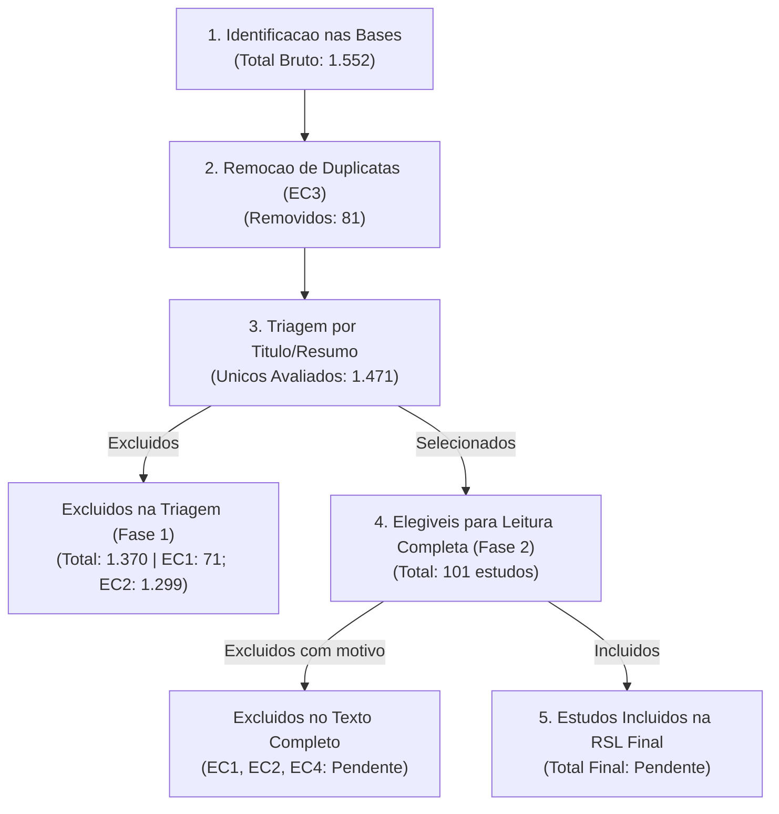

# Diagrama de Fluxo PRISMA 2020 (Contabilidade Auditada dos Estudos)

Este documento registra a contagem precisa e auditada de cada etapa da revisao (`[DEC-003]`). Esses numeros integram o diagrama de fluxo oficial para o artigo e a dissertacao.

---

## 1. Identificacao (Identification)
- Registros identificados nas bases:
  - **Springer Link:** `1000`
  - **ACM Digital Library:** `198`
  - **Scopus:** `195`
  - **Web of Science:** `83`
  - **ScienceDirect:** `62`
  - **IEEE Xplore:** `14`
  - Outras fontes: `0`
- **Total de registros identificados:** **`1552`** (1000 Springer Link + 198 ACM + 195 Scopus + 83 Web of Science + 62 ScienceDirect + 14 IEEE)

---

## 2. Triagem e Remocao de Duplicatas (Screening - Title & Abstract)
- Registros duplicados removidos (EC3): **`81 duplicatas`** (Web of Science: 58, Springer Link: 19, IEEE Xplore: 3, ACM DL: 1)
- **Total de registros unicos avaliados por Titulo e Resumo:** **`1.471 artigos`**
- **Estudos excluidos na triagem auditada de Titulo e Resumo:** **`1.370 estudos`**
  - Excluidos por EC1 (Literatura cinzenta nao validada / volumes de proceedings / editoriais): `71`
  - Excluidos por EC2 (Populacao fora do Ensino Basico / ensino superior / evasao estritamente socioeconomica sem fatores socioemocionais ou covariavel clinica alheia): `1.299`
- **Total de estudos selecionados para Leitura de Texto Completo (Fase 2):** **`101 estudos`** (Taxa de selecao: 6,9%)
  - *Scopus:* 61 estudos
  - *Springer Link:* 20 estudos
  - *Web of Science:* 10 estudos
  - *ACM DL:* 4 estudos
  - *ScienceDirect:* 3 estudos
  - *IEEE Xplore:* 3 estudos

---

## 3. Elegibilidade (Eligibility - Fase 2 em Andamento)
- **Artigos buscados para leitura de texto integral:** `101`
- Artigos nao recuperados (sem acesso ao PDF - EC4): `[Pendente_Fase2]`
- Artigos avaliados em texto integral: `[Pendente_Fase2]`
- Artigos excluidos apos leitura integral (com justificativas IC/EC): `[Pendente_Fase2]`
- **Total de artigos excluidos na leitura integral:** `[Pendente_Fase2]`

---

## 4. Inclusao (Included - Fase 2 em Andamento)
- **Estudos incluidos na sintese qualitativa/quantitativa final:** `[Pendente_Fase2]`

---

## Diagrama Visual em Mermaid

